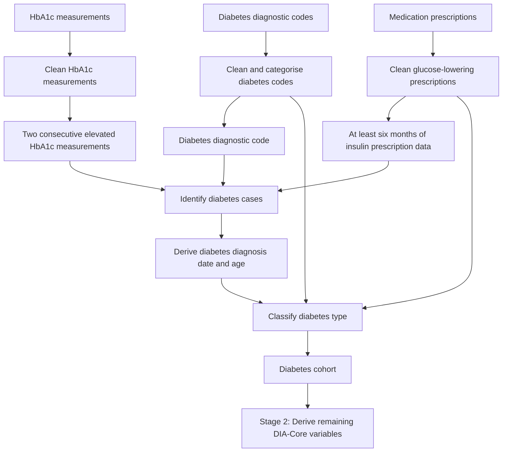

---
title: Diabetes cohort ascertainment
---

# Stage 1: Diabetes cohort ascertainment and classification

## Overview

The first stage of implementing the Diabetes Core Dataset (DIA-Core) involves identifying individuals with diabetes, determining their date and age at diagnosis, and classifying diabetes type.

We recommend following the algorithms developed by the [BHF HDR UK Diabetes Data Science Catalyst (DDSC) Defining Diabetes project](https://bhf-dsc-hds.shinyapps.io/hds_phenotypes_diabetes/). The algorithms and associated codelists are also available via the [HDR UK Phenotype Library](https://phenotypes.healthdatagateway.org/phenotypes/PH4062/version/9273/).

The following sections provide step-by-step implementation guidance for applying these algorithms to routinely collected primary care data.

&nbsp;

## Input data requirements

The following input data are required:

- Patient demographics.
- Primary care registration information.
- Primary care clinical observations, including diabetes diagnostic codes and HbA1c measurements.
- Primary care medication prescriptions, including insulin and non-insulin glucose-lowering medications.

See the [standardised input data requirements](data_requirements.md) for further details of the tables, variables and coding systems required.

&nbsp;

## Prerequisites and general data cleaning

Before implementing the diabetes cohort ascertainment algorithm:

- Date of birth should be available for all patients (at minimum, year of birth; month and year preferred). Patients without this information should be excluded.
- Where the exact date of birth is unavailable, we have developed an [algorithm for defining date of birth](../../code_lists/sociodemographics/date%20of%20birth/index.md); however, its use may be restricted by data source-specific governance or regulatory requirements.
- Sex should be available for all patients.
- Additional data cleaning steps depend on the data source. For example, in CPRD we additionally exclude patients without valid registration dates, those aged over 115 years, and those from practices with anomalous mortality rates.
- Date of death should preferentially be obtained from national mortality registration data over primary or secondary care recorded dates, where available.
- Relevant historical diabetes diagnostic codes may be stored in different source tables, such as problem or observation tables.
- The last observable date should reflect the end of available follow-up for each patient, taking into account the data collection end date, deregistration date and date of death, where applicable.

&nbsp;

## Implementation overview

The implementation is divided into four components:

1. Extraction and cleaning of diabetes-related clinical and medication records.
2. Identification of individuals with diabetes.
3. Derivation of diabetes diagnosis date and age at diagnosis.
4. Classification of diabetes type.

&nbsp;

## A. Extraction and cleaning of diabetes-related records

### A1. Diabetes diagnostic codes

Use the [diabetes diagnostic codelists](../../code_lists/conditions/diabetes/index.md) to extract and clean all instances of diabetes diagnostic codes.

| Step | Description | Output | Quality assurance |
|---|---|---|---|
| A1.1 | Extract and clean all diabetes diagnostic codes, categorised as type 1, type 2, other or not otherwise specified (NOS). | Longitudinal table containing patient identifier, observation date and diabetes code category. | Distribution of code dates. Number and percentage of patients with diabetes diagnostic codes. |
| A1.2 | Identify the earliest clean diabetes diagnostic code per patient. | One row per patient with earliest diabetes code date. | Distribution of earliest diabetes code dates. |
| A1.3 | Count type 1 and type 2-specific diabetes codes per patient. | One row per patient with counts of type 1 and type 2-specific codes. | Distribution of code counts and number of patients with codes for both types. |

&nbsp;

### A2. HbA1c measurements

Use the [HbA1c codelists and cleaning rules](../../code_lists/investigations/HbA1c/index.md) to identify and clean all available HbA1c measurements.

| Step | Description | Output | Quality assurance |
|---|---|---|---|
| A2.1 | Extract and clean all HbA1c measurements, standardising values to mmol/mol. Combine multiple measurements on the same day according to the HbA1c cleaning rules. | Longitudinal table containing patient identifier, measurement date and cleaned HbA1c value. One row per patient per date. | Distribution of HbA1c values and measurement dates. |
| A2.2 | Identify the earliest elevated HbA1c measurement (>=48 mmol/mol) per patient. | One row per patient with earliest elevated HbA1c date. | Distribution of dates and number of patients with elevated HbA1c. |
| A2.3 | Identify patients with two consecutive elevated HbA1c measurements (>=48 mmol/mol) within two years, with no intervening non-elevated measurement. Retain the date of the first measurement in the earliest qualifying pair. | One row per patient meeting this criterion, including the date of the first elevated HbA1c in the qualifying pair. | Number of patients meeting the criterion. |

&nbsp;

### A3. Glucose-lowering medication prescriptions

Use the [diabetes medication codelists](../../code_lists/medications/diabetes%20medications/index.md) to extract and clean insulin and non-insulin glucose-lowering medication prescriptions.

| Step | Description | Output | Quality assurance |
|---|---|---|---|
| A3.1 | Extract and clean all insulin and non-insulin glucose-lowering medication prescriptions. | Longitudinal prescription tables containing patient identifier, prescription date, drug class, drug substance, and available dose and quantity information. | Distribution of prescription dates. Number of patients prescribed insulin, non-insulin glucose-lowering medications, and both. |
| A3.2 | Identify the earliest and latest insulin prescription dates per patient. Calculate the number of days between these dates and the number of days between the latest insulin prescription and the last observable date. | One row per patient with earliest and latest insulin prescription dates, duration of recorded insulin use and time since latest prescription. | Distribution of duration of recorded insulin use and time since latest insulin prescription. |

There may be multiple prescriptions for an individual on the same date. These should be retained where they represent distinct prescriptions.

&nbsp;

## B. Identification of individuals with diabetes

Individuals meeting at least one of the following criteria are identified as diabetes cases:

1. A recorded diabetes diagnostic code.
2. Two consecutive elevated HbA1c measurements (>=48 mmol/mol) within two years.
3. At least 183 days between the earliest and latest recorded insulin prescriptions.

| Step | Description | Output | Quality assurance |
|---|---|---|---|
| B1 | Combine the patient-level information derived in section A to identify individuals meeting at least one of the three diabetes ascertainment criteria. | One row per patient with diabetes, including separate binary indicators for each ascertainment criterion. | Total number and percentage of patients identified as diabetes cases. Number of patients meeting each criterion and each combination of criteria. |

Retaining separate indicators for the three criteria enables comparison of the relative contribution of different data sources to diabetes ascertainment.

&nbsp;

## C. Derivation of diabetes diagnosis date and age

For individuals identified as having diabetes, use the earliest diabetes diagnostic code and elevated HbA1c measurements to estimate the date of diabetes diagnosis, following the DDSC algorithm.

| Step | Description | Output | Quality assurance |
|---|---|---|---|
| C1 | Derive diabetes diagnosis date using the earliest diabetes diagnostic code and the first elevated HbA1c measurement from the earliest qualifying pair, following the [diabetes diagnosis date algorithm](../../code_lists/conditions/diabetes/index.md). | One row per patient with estimated diabetes diagnosis date. | Distribution of diagnosis dates and number of patients with missing diagnosis dates. |
| C2 | Identify diagnosis dates within -30 to +90 days (inclusive) of GP registration start date, as these may represent pre-existing diagnoses. | Indicator of potentially unreliable diagnosis dates. | Number and percentage of patients with diagnosis dates around registration. |
| C3 | Calculate time from diabetes diagnosis to earliest insulin prescription in days. Identify patients whose earliest insulin prescription occurred more than one year before the estimated diagnosis date. | Time from diagnosis to insulin initiation and indicator of potentially unreliable diagnosis dates. | Distribution of time from diagnosis to insulin initiation. |
| C4 | Apply diagnosis date cleaning rules and calculate age at diagnosis using patient date of birth, to one decimal point where date precision permits. | Cleaned diabetes diagnosis date and age at diagnosis. | Distribution of diagnosis dates and ages. Number and percentage of patients with missing diagnosis date or age. |

We recommend setting potentially unreliable diagnosis dates to missing where they occur around GP registration or where insulin initiation predates the estimated diagnosis date by more than one year. Individuals should remain in the diabetes cohort even if their diagnosis date cannot be reliably determined.

See the [diabetes diagnosis date rules](../../code_lists/conditions/diabetes/index.md) for further information.

&nbsp;

## D. Classification of diabetes type

Apply the [DDSC diabetes classification algorithm](https://bhf-dsc-hds.shinyapps.io/hds_phenotypes_diabetes/) using the diabetes diagnostic codes, diagnosis information and medication prescription history derived in the preceding steps.

| Step | Description | Output | Quality assurance |
|---|---|---|---|
| D1 | Apply the DDSC diabetes type classification algorithm. | One row per patient with assigned diabetes classification. | Number and percentage of patients in each diabetes classification category. |
| D2 | Combine diabetes classification with diabetes diagnosis date and age at diagnosis. | Patient-level diabetes cohort. | Distribution of age at diagnosis by diabetes type and percentage with missing diagnosis dates. |

The DDSC algorithm assigns individuals to the following categories:

- Type 1 diabetes.
- Type 2 diabetes.
- Diabetes other.
- Diabetes not otherwise specified (NOS).
- Diabetes unlikely.

See the [diabetes classification rules](../../code_lists/conditions/diabetes/index.md) for further information, including classification of individuals with conflicting type 1 and type 2 diabetes diagnostic codes.

Diabetes remission should be recorded separately from diabetes type, where information is available.

&nbsp;

## Output of Stage 1

The output of Stage 1 is a patient-level diabetes cohort with one row per patient.

We recommend retaining the following variables to support reproducibility and quality assurance:

| Variable | Description |
|---|---|
| patient_id | Unique pseudonymous patient identifier |
| diabetes_code | Indicator of meeting the diabetes diagnostic code criterion |
| elevated_hba1c_pair | Indicator of meeting the elevated HbA1c criterion |
| insulin_6months | Indicator of meeting the insulin prescription criterion |
| earliest_diabetes_code_date | Earliest clean diabetes diagnostic code date |
| earliest_elevated_hba1c_date | Earliest elevated HbA1c measurement date |
| earliest_qualifying_hba1c_date | First measurement date in the earliest qualifying HbA1c pair |
| earliest_insulin_date | Earliest recorded insulin prescription date |
| latest_insulin_date | Latest recorded insulin prescription date |
| diabetes_diagnosis_date | Estimated diabetes diagnosis date after cleaning |
| diabetes_diagnosis_age | Estimated age at diabetes diagnosis |
| diagnosis_near_registration | Indicator of diagnosis date around GP registration |
| insulin_before_diagnosis | Indicator of insulin initiation more than one year before estimated diagnosis |
| time_to_insulin | Time from diabetes diagnosis to earliest insulin prescription |
| type1_code_count | Number of type 1-specific diabetes codes |
| type2_code_count | Number of type 2-specific diabetes codes |
| diabetes_type | Diabetes classification derived using the DDSC algorithm |

Individuals classified as 'diabetes unlikely' should be retained in the intermediate output for quality assurance, with their inclusion or exclusion from the final diabetes cohort documented.

The longitudinal tables of cleaned diabetes diagnostic codes, HbA1c measurements and glucose-lowering medication prescriptions should also be retained.

The diabetes cohort can then be used to implement [Stage 2: Derivation of the remaining DIA-Core variables](core_variables.md).

&nbsp;

## Quality assurance

For continuous variables and dates, we recommend reporting the minimum, 25th percentile, median, 75th percentile, maximum and mode, where appropriate.

For categorical variables, we recommend reporting counts, percentages and missingness.

Quality assurance outputs should be reviewed at each stage of the implementation to identify potential data quality issues and unexpected differences between data sources.

&nbsp;

## Previous implementation

An SQL implementation developed by Kent, Medway and Sussex (KMS) SDE, based on an earlier iteration of the diabetes cohort ascertainment steps, is available [here](KMS%20implementation/README.md).
