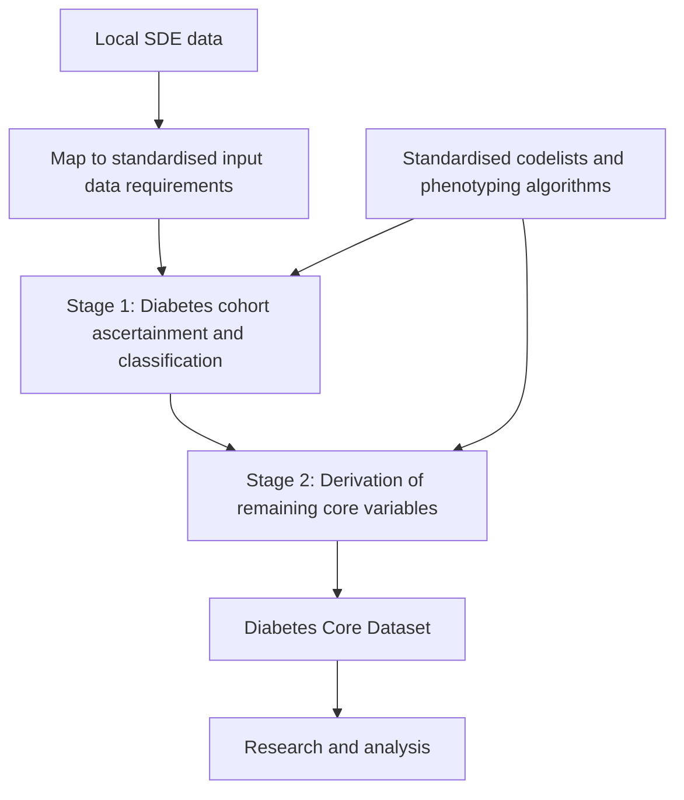

# Diabetes Core Dataset (DIA-Core)

## Overview

The Diabetes Core Dataset (DIA-Core) defines a standardised set of variables describing diabetes diagnosis, classification, treatment and key outcomes, derived from routinely collected health data.

The dataset was agreed by expert consensus with input from patients and the public. Further information on the development and content of DIA-Core is available in the [preprint manuscript](https://www.medrxiv.org/content/10.64898/2026.08.03.26359232v1).

The Diabetes Core Dataset is also listed as a tool on the [HDR UK Health Data Research Gateway](https://healthdatagateway.org/en/tool/426).

&nbsp;

## Implementing the Diabetes Core Dataset

The DIA-Core implementation framework is designed to support consistent and reproducible implementation across Secure Data Environments (SDEs) and other routinely collected health data sources.

Implementation involves two main stages:

### Stage 1: Diabetes cohort ascertainment and classification

Identification of individuals with diabetes, estimation of diabetes diagnosis date and age at diagnosis, and classification of diabetes type using algorithms developed by the BHF HDR UK Diabetes Data Science Catalyst (DDSC).

[View Stage 1 implementation guidance](diabetes_cohort.md).

### Stage 2: Derivation of the remaining core dataset variables

Extraction, cleaning and derivation of demographic information, clinical measurements, biomarkers, diabetes complications, lifestyle information and medication prescriptions.

[View Stage 2 implementation guidance](core_variables.md).

&nbsp;

## Implementation pathway

A [standardised input data specification](data_requirements.md) defines the logical tables, variables and coding systems required to implement DIA-Core. This enables SDEs to map their local data structures to a common framework, identify gaps in data availability and facilitate consistent implementation across the NHS SDE Network.

Quality assurance checks are provided throughout the implementation guidance.

&nbsp;

## Variables included in the Diabetes Core Dataset

Patient identifiers required for data linkage and information describing the data source (such as start and end dates, including patient registration dates in primary care) are considered structural requirements of the dataset and are not explicitly listed below.

| Domain | No. | Data item |
|---------|-----|-----------|
| Demographics and social determinants of health | 1 | Date of birth |
| Demographics and social determinants of health | 2 | Sex |
| Demographics and social determinants of health | 3 | Ethnicity |
| Demographics and social determinants of health | 4 | Date of death |
| Diabetes features | 5 | Age/date of diabetes diagnosis |
| Diabetes features | 6 | Diabetes type (including remission) |
| Clinical measurements | 7 | BMI |
| Clinical measurements | 8 | Weight |
| Clinical measurements | 9 | Height |
| Clinical measurements | 10 | Blood pressure |
| Biomarkers | 11 | HbA1c |
| Biomarkers | 12 | Lipids: total cholesterol |
| Biomarkers | 13 | Lipids: HDL |
| Biomarkers | 14 | Lipids: triglycerides |
| Biomarkers | 15 | Liver function: ALT |
| Biomarkers | 16 | Kidney function: eGFR |
| Biomarkers | 17 | Kidney function: urine ACR |
| Diabetes complications | 18 | Retinopathy |
| Diabetes complications | 19 | Foot complications (ulcer, infection, loss of sensation/pulse) |
| Diabetes complications | 20 | Lower limb amputation (minor and major) |
| Diabetes complications | 21 | Cardiovascular disease: overall and by subtype (including hypertension and heart failure) |
| Diabetes complications | 22 | Chronic kidney disease stage plus transplant, dialysis |
| Diabetes complications | 23 | Diabetic ketoacidosis (DKA) / hyperosmolar hyperglycaemic state (HHS) |
| Lifestyle | 24 | Alcohol status |
| Lifestyle | 25 | Smoking status |
| Treatment of diabetes and associated conditions | 26 | Diabetes glucose-lowering medication |
| Treatment of diabetes and associated conditions | 27 | CGM prescription |
| Treatment of diabetes and associated conditions | 28 | Lipid lowering medication |
| Treatment of diabetes and associated conditions | 29 | Blood pressure lowering medication |
| Treatment of diabetes and associated conditions | 30 | Antiplatelet therapy |

&nbsp;

## Dataset structure

For each core variable, we recommend retaining all available instances for each patient, where applicable. This longitudinal structure, including repeated clinical measurements, medication prescriptions and clinical events, maximises flexibility for downstream research use.

All tables should be linkable using a consistent pseudonymous patient identifier.

The physical structure of the dataset may vary between SDEs, but variable definitions, coding systems and derivation rules should be consistent wherever possible.

&nbsp;

## Previous implementations

An SQL implementation developed by Kent, Medway and Sussex (KMS) SDE, based on an earlier iteration of the DIA-Core implementation guidance, is available [here](KMS%20implementation/README.md).
